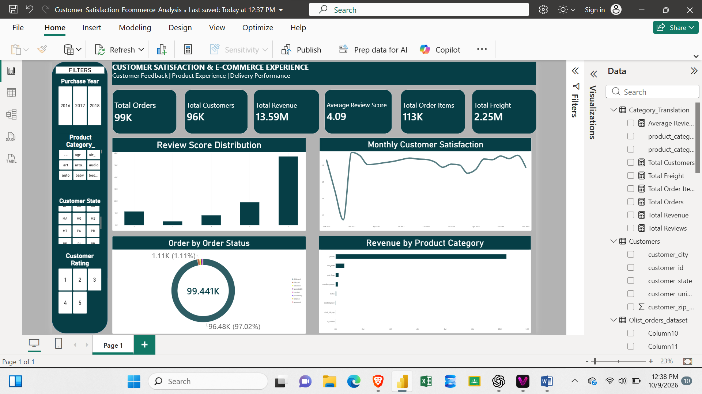

# Customer Satisfaction & E-Commerce Experience Analysis

## Project Overview

This project analyses customer satisfaction and e-commerce performance using the Brazilian Olist e-commerce dataset.

The objective is to examine customer feedback, review scores, order activity, revenue, and product categories to identify patterns in the customer experience.

## Tools Used

- Microsoft Power BI
- Microsoft Excel
- Power Query
- DAX

## Dashboard Features

The Power BI dashboard includes:

- Total Orders
- Total Customers
- Total Revenue
- Average Review Score
- Review Score Distribution
- Monthly Customer Satisfaction
- Order Status Analysis
- Revenue by Product Category

Interactive slicers allow users to explore the data by purchase year, product category, customer state, and customer rating.

## Dataset

The analysis uses the Brazilian E-Commerce Public Dataset by Olist, available on Kaggle.

## Project Objective

The goal is to turn e-commerce data into meaningful insights that can help businesses understand customer feedback, monitor sales performance, and identify opportunities to improve the customer experience.

## Dashboard Preview

